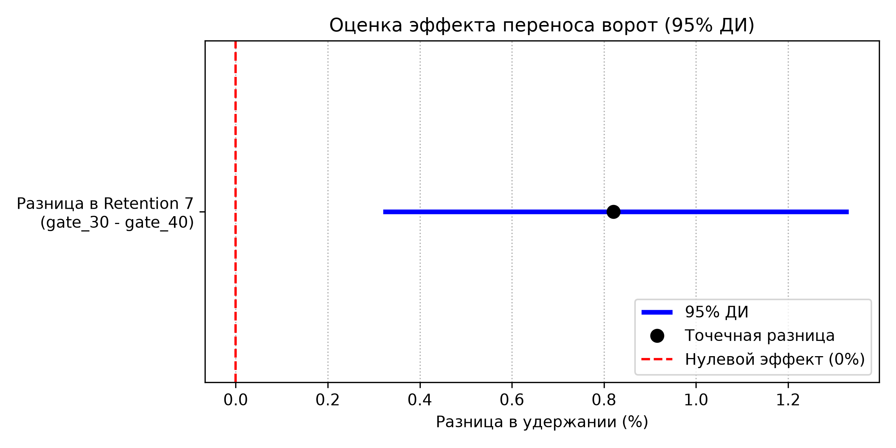

# Анализ A/B-теста в мобильной игре (Cookie Cats)

## О проекте
Данный проект посвящен анализу результатов A/B-теста в популярной мобильной игре Cookie Cats. Разработчики перенесли внутриигровые «ворота» (момент, когда игроку нужно подождать или позвать друзей) с 30-го уровня на 40-й, чтобы проверить, улучшит ли это удержание (Retention) и вовлеченность игроков.

**Цель:** Проверить статистическую значимость влияния переноса ворот на удержание и вовлеченность, и дать бизнес-рекомендацию (внедрять фичу или нет).

## Данные
В датасете `cookie_cats.csv` (90 189 строк) содержатся следующие колонки:
* `userid` — уникальный идентификатор игрока.
* `version` — группа пользователя (`gate_30` — контрольная, `gate_40` — тестовая).
* `sum_gamerounds` — количество раундов, сыгранных игроком за 14 дней.
* `retention_1` — вернулся ли игрок в игру на 1-й день (True/False).
* `retention_7` — вернулся ли игрок в игру на 7-й день (True/False).

## Этапы анализа
1. **Подготовка данных:** загрузка в облачную PostgreSQL, проверка на пропуски и дубликаты. Очистка выбросов в `sum_gamerounds` методом IQR (отсечены аномальные значения > 120 раундов).
2. **A/A-тест:** проверка баланса групп. Разница в размерах групп составила менее 1%, рандомизация прошла успешно.
3. **Основной анализ (Z-тест для долей):** проверка гипотезы о равенстве Retention в двух группах.
4. **Доверительные интервалы (Bootstrap):** расчет 95% ДИ для разницы в Retention (10 000 итераций).
5. **Анализ вовлеченности (Манн-Уитни):** так как распределение раундов не является нормальным (проверено через Q-Q plot), использован непараметрический тест.
6. **Бизнес-вывод.**

## Ключевые результаты

**1. Удержание на 7-й день (Retention 7)**
* `gate_30` (контроль): **19.02%**
* `gate_40` (тест): **18.20%**
* **p-value = 0.0016** (разница статистически значима).
* **95% ДИ:** [0.32%; 1.33%] (интервал не содержит ноль).

**2. Удержание на 1-й день (Retention 1)**
* `gate_30`: 44.82%
* `gate_40`: 44.23%
* p-value = 0.0744 (разница **не значима**).

**3. Вовлеченность (Engagement)**
* Медиана раундов в обеих группах = 13.
* Хотя p-value = 0.0389, разница в средних (0.06 раунда) **ничтожна** и не имеет практической ценности для бизнеса.

*(График доверительного интервала, подтверждающий значимость падения Retention 7)*

## Бизнес-вывод
Перенос ворот с 30-го на 40-й уровень **негативно сказывается на долгосрочном удержании** игроков (Retention 7 падает, а разница статистически значима). При этом вовлеченность игроков (количество сыгранных раундов) не растет. 

**Рекомендация:** Фичу **не внедрять**. Ворота следует оставить на 30-м уровне.

## Используемый стек
* **SQL (PostgreSQL)** — агрегация данных.
* **Python** (Pandas, SciPy, Statsmodels) — статистические тесты, ресэмплинг, обработка данных.
* **Python** (Matplotlib) — визуализация (Q-Q plot, Forest Plot).